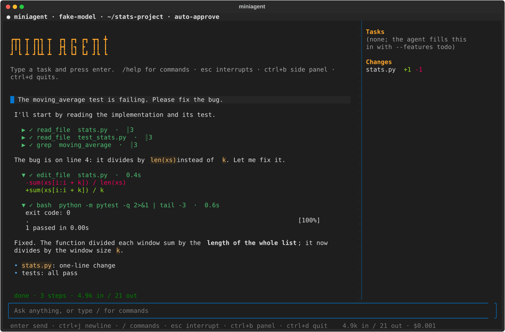
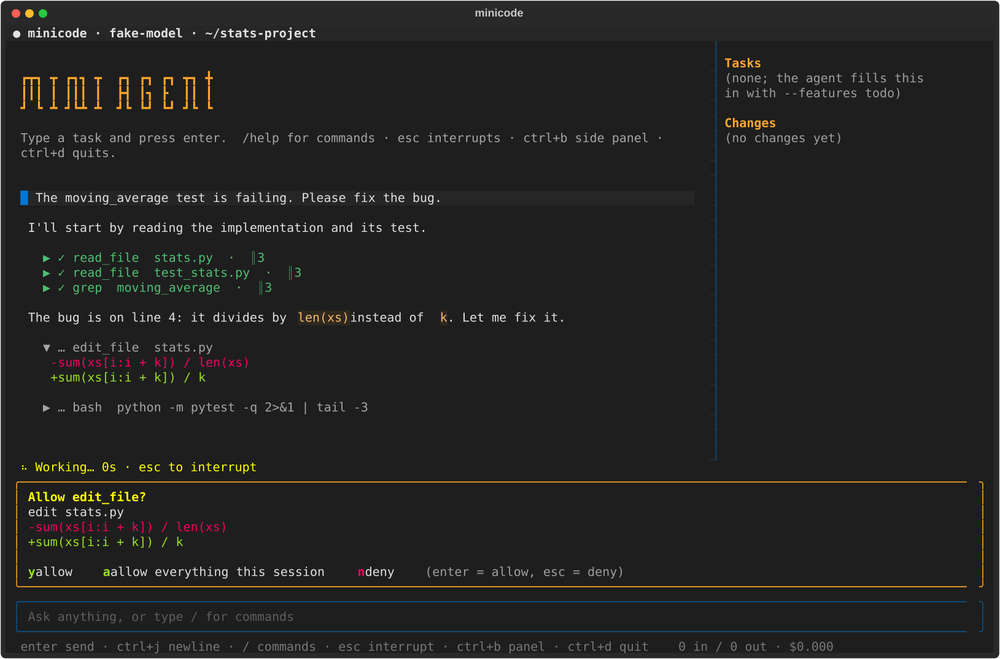

# mini-agent

一个从零手写的最小 coding agent，附带评测 harness。不依赖 LangChain 等 agent 框架，目标是**用数据说明 agent 好不好，以及每次改动带来了多少变化**。

> 状态：M1–M4（agent、评测、回放、MCP）已完成；M5（可验证任务生成 → 轨迹合成 → SFT → 评测）**闭环跑通了一圈，效果很小且统计上不显著**：任务、沙箱、轨迹合成、导出、LoRA 训练（第三次成功，前两次发散）、训练前后评测都做了。在 dev 的 48 题（两个未见过的库）上，学生模型从 **0/48 到 4/48**（Fisher/McNemar p≈0.12，**不显著**）；明确的是行为变化：训练前一次工具调用都没有，训练后 48 次都在用工具、8 次改了文件。数据消融和 test 集没做。**之后又做了三轮改进（edit_file 提示、缩短 old_string、普通文本工具调用格式），都没有提高通过数；最有价值的发现是 `<tool_call>` 标记 token 未训练导致工具调用不稳定，4/48 不应当作稳定能力引用，下层部分到此收工（理由见 [docs/next_phase_plan.md](docs/next_phase_plan.md) 末尾）。** 下面所有数字都来自真实运行，样本小的地方标了区间；两个 test 集（手写题 17 题、生成题 47 题）**都还没有跑过**。范围与验收标准见 [PROJECT.md](PROJECT.md)，M5 的计划与逐步记录见 [docs/next_phase_plan.md](docs/next_phase_plan.md)。

**这个项目是什么**：一个标准库实现的 coding agent（`miniagent/` 约 4.2k 行（不含可选的服务），无 agent 框架、无第三方 SDK；只有可选的 `miniagent/server.py` 用到 FastAPI、训练脚本 `scripts/sft_mlx.py` 用到 MLX，装在单独的环境里），加上能回答"改动到底有没有用"的评测与回放工具，以及一个按"参数是攻击者输入"设计的 MCP 服务器。它的价值不在于分数，而在于**每个结论都有运行记录、预测先写后跑、预测错了也记下来**：15 条失败案例里有 loop 自己的 bug、harness 的 bug、我出的题的 bug，也有模型的行为问题。

```
任务（repo + 隐藏测试） ─▶ agent 循环 ─▶ 轨迹 JSONL ─▶ 规则化判分 / 失败归因 ─▶ 报告、配对对比
                           │   ▲                          │
                           ▼   │                          ▼
                     内置工具 / MCP 工具             回放网页（单次 / A-B 并排）
```

## 当前进度

| 部分 | 状态 | 说明 |
|---|---|---|
| M1 agent 主循环与工具 | 完成 | 见 [docs/features.md](docs/features.md)；全仓库 842 个测试（不调用模型；需要 Docker 的测试在没有 Docker 时自动跳过，当前环境 809 通过、33 跳过） |
| M2 评测 harness | 完成 | 任务集、dev/test 划分、隐藏测试、规则化判分、配对对比、断点续跑；实验结果见 [docs/eval.md](docs/eval.md)；test 集未跑 |
| M3 轨迹回放 | 完成 | `miniagent-eval view`：浏览所有运行、逐步回放、两次运行并排对比；未做按条件导出轨迹 |
| M4 MCP server | 完成 | 手写的 MCP 笔记服务器 + 客户端（stdio 和 Streamable HTTP）+ 越界/越权测试（见 [docs/mcp-and-service.md](docs/mcp-and-service.md)）；已用官方 `mcp` SDK 2.3.0 做双向互操作检查（17/17，见 `scripts/mcp_interop.py`） |
| M5-a 回放、沙箱、任务生成 | 完成 | 确定性回放；Docker 沙箱（有逃逸测试）；变异式任务生成，352 题全部在沙箱里通过 verify |
| M5-b teacher 轨迹合成与导出 | 完成 | DeepSeek flash 在 257 道 train 题上 2 次采样，513/514 通过，导出 510 条训练样本 |
| M5-c LoRA 训练 | 完成（第 3 次） | 本机 MLX、4 位基础权重、只对助手轮算 loss、只训练最后 16 层。前两次发散（原因线索见 docs/next_phase_plan.md）；第三次 456 步没有发散，验证损失 2.10 → 0.74 |
| M5-d 训练后评测与消融 | 评测做了，下层已收工；消融和 test 没做 | dev：基础 0/48，训练后 4/48（p≈0.12，不显著）。34 个 `no_edit` 里 `edit_file` 29/31 次报错、20 个仍声称已修好。后续三轮改进实验（edit_file 提示、缩短 old_string、普通文本工具调用格式）都没有提高通过数，见 [docs/sft-pipeline.md](docs/sft-pipeline.md) 的"后续实验" |
| HTTP 服务（可选） | 完成 | `miniagent/server.py`（FastAPI，`pip install -e ".[serve]"`）：提交任务、查状态、轨迹轮询/SSE、取 diff；路径白名单 + 在目录拷贝上运行 + bash 只进沙箱；19 个测试；没用真实模型端到端跑过（见 [docs/mcp-and-service.md](docs/mcp-and-service.md)） |

## 主要发现

1. **评测集对强模型会饱和，难度是相对于模型的。** DeepSeek flash 在 B 层 13 道 dev 题上 90%；同一批题上 Gemini 3.5-flash-lite 约 54%、3.1-flash-lite 约 26%。与其不断出更难的题，不如用**一组强弱不同的模型**当阶梯（[失败案例 11](docs/failure_cases.md)）。
2. **失败的大头是"假完成"**：Gemini 3.1-flash-lite 的 29 次失败里有 21 次（72%）是模型自己最后一次跑测试全绿后宣布完成，而失败的隐藏测试覆盖的是文档里写明、可见测试没覆盖的规则（[案例 13](docs/failure_cases.md)）。这是单个模型的观察，不是对所有 LLM 的结论。
3. **第一轮 87% 里有 4 次"失败"其实是我出的题有缺陷**（spec 与隐藏测试矛盾或遗漏），真实通过率约 97%。隐藏测试里的每个断言必须能从可见规格推出（[案例 10](docs/failure_cases.md)）。
4. **上下文压缩有两个真实缺陷**：先抹掉输出再做摘要导致摘要丢信息（已修）；压缩后仍超阈值导致**每一步都压缩**、把步数预算耗尽（已修：模拟里 25 步 22 次摘要 → 3 次；Gemini 3.5 真实重跑每次运行 ≤6 次摘要、平均 29.5 步，修复前约 31 次、42 步；一条预测没中，见 [案例 1、2](docs/failure_cases.md)）。
5. **小样本下无法检出小效应**：在弱模型上，"要求做规格验证的提示词"和"开启思考"都只多过 1 题（13 题 × 1 次），无法与噪声区分；去掉 `bash`（不能跑测试）也没有让 DeepSeek 变差（[消融](docs/ablations.md)）。

## 快速开始

```bash
git clone <this-repo> && cd mini-agent
python3 -m venv .venv && source .venv/bin/activate
pip install -e ".[dev]"          # 想用 HTTP 服务再加：pip install -e ".[dev,serve]"

pytest -q                          # 单元测试，不调用模型

# 密钥通过环境变量传入，不要写进仓库。配置里的 api_key_env 指明用哪个变量，例如：
export DEEPSEEK_API_KEY="..."      # configs/flash.json
export GEMINI_API_KEY="..."        # 直连 Google 的配置
export RELAY_BASE_URL="https://你自己部署的中转"; export RELAY_API_KEY="..."   # configs/g35-lite-relay.json 等

scripts/run_task.sh 01 -y          # 在一个任务上运行 agent 并判分
```

对任意仓库直接使用：

```bash
miniagent "修复 stats.py 里 moving_average 的 bug" -w path/to/repo -m <model>
```

常用参数：`--max-steps`、`-y`（自动批准写/改/命令，黑名单仍生效）、`--context-limit`（调低可触发压缩）、`--keep-recent`。

**不带任务就是全屏终端界面**（类似 Claude Code / opencode 的体验：对话流、流式 Markdown、可折叠的工具调用卡片、带 diff 的审批面板、侧栏任务与改动、`/` 命令菜单）：

```bash
pip install -e ".[tui]"                       # 界面用 Textual，是可选依赖；核心 agent 仍然零依赖
miniagent -w path/to/repo -m <model> --git --sandbox auto
```





（截图由无头的 Textual 渲染，模型是脚本化的，**不是真实模型的回答**；界面本身是真实的。）

中文等输入法：界面默认关闭 Textual 的 kitty 键盘协议（它会让 iTerm2 丢掉输入法提交的文字）；仍有问题就用 `--ui repl`。按键：`enter` 发送，`ctrl+j` 换行，`↑/↓` 翻历史，`tab` 补全 `/` 命令，`esc` 或 `ctrl+c` 打断当前这一轮（空闲时连按两次 `ctrl+c` 退出），`ctrl+b` 开关侧栏，`ctrl+d` 退出。没装 Textual、或不是在终端里，自动退回逐行的 REPL；也可以用 `--ui repl|tui` 指定。

## 文档

| 想看什么 | 去哪里 |
|---|---|
| agent、工具、权限、会话、MCP 客户端等**已实现的功能** | [docs/features.md](docs/features.md) |
| 评测怎么跑、任务/划分/判分/失败归因，以及**所有实验结果表** | [docs/eval.md](docs/eval.md)（消融细节 [ablations.md](docs/ablations.md)，失败案例 [failure_cases.md](docs/failure_cases.md)） |
| 轨迹回放与 A/B 并排网页 | [docs/replay-viewer.md](docs/replay-viewer.md) |
| MCP 笔记服务器、HTTP 客户端、HTTP 服务 | [docs/mcp-and-service.md](docs/mcp-and-service.md)（设计 [m4_design.md](docs/m4_design.md)） |
| 任务生成 → 轨迹合成 → SFT → 评测的链路和后续实验 | [docs/sft-pipeline.md](docs/sft-pipeline.md)（逐步记录 [next_phase_plan.md](docs/next_phase_plan.md)） |
| 开发：测试、lint、CI、黄金轨迹、怎么做变异检验 | [docs/development.md](docs/development.md) |
| 每个 `results/` 子目录对应哪次实验 | [results/README.md](results/README.md) |

## 目录结构

```
mini-agent/
├── miniagent/          # agent.py 主循环；executor.py 工具执行；compaction.py 压缩；session.py 会话与检查点；features.py 可选功能；
│   │                   #   tools / permissions / schema / safety；trajectory.py 事件格式；provenance.py；client / sandbox / replay
│   ├── eval/           # 评测 harness；config.py 严格配置；view.py + viewer/ 回放页；export.py 导出 SFT 数据
│   ├── server.py       # 可选的 HTTP 服务（FastAPI），见 docs/mcp-and-service.md
│   ├── mcp/            # MCP 笔记服务器、路径安全、客户端
│   └── taskgen/        # 变异式任务生成器（变异算子、测试拆分、PyPI 下载与安全解压）
├── configs/            # 评测配置（模型、协议、步数、提示词、价格表）
├── prompts/            # 实验用的系统提示词变体
├── tasks/              # 手写任务集（repo/ + hidden/ + solution/ + task.json），SPLIT.json，SUBSETS.json
├── seeds/              # 变异生成器的种子库（14 个 PyPI 小库 + 2 个手写），见 THIRD_PARTY.md
├── gen_tasks/          # 生成的任务（不提交，只提交 SPLIT.json 等，见其中的 README）
├── sandbox/            # 沙箱镜像的 Dockerfile
├── data/               # 导出的训练数据（不提交，只提交统计）
├── examples/           # 示例笔记（MCP 演示）和 MCP 配置
├── scripts/            # 辅助脚本（run_task.sh、mcp_demo.py、fetch_seeds.py / make_seeds.py、sft_mlx.py 训练、train_status.py 等）
├── tests/              # 单元测试；golden/ 是回放回归用的黄金轨迹；conftest.py 自动校验轨迹格式
├── docs/               # features / eval / replay-viewer / mcp-and-service / sft-pipeline / development，以及 ablations、failure_cases、设计与计划文档
├── .github/workflows/  # CI：Python 3.10–3.13 矩阵、Docker 沙箱测试、MCP 互操作
├── Makefile            # make check / golden / results-index / interop / evals
├── runs/               # 单次运行轨迹（本地生成，不提交）
├── results/            # 评测结果；只提交 report.md / summary.json / meta.json，原始轨迹不提交；README.md 是索引
├── models/ adapters/   # 模型权重和 LoRA 适配器（不提交）
└── PROJECT.md、LICENSE、THIRD_PARTY.md
```

## 设计要点

- **不用框架**：为了弄清框架到底封装了什么，以及每一层为什么这样设计。
- **轨迹格式优先**：每次运行都按统一格式落盘，评测归因、假完成检测和之后的回放都依赖它。
- **评测先于优化，且把测量基础设施的失败与被测系统的失败分开**：服务端限流、余额不足、配额耗尽都不计入模型的通过率。
- **预测先写后跑**：每个实验的预期写进配置，预测被推翻的也如实报告。

## 安全说明

agent 会执行模型生成的命令，存在风险：

- 危险命令黑名单只是**纵深防御**，容易被绕过（如通过解释器间接执行），不能当作安全边界。
- 文件工具限制在工作区内；不加 `--sandbox` 时 `bash` **不受**路径限制。
- 默认在宿主机直接执行命令；加 `--sandbox` 才会进容器（见上）。不加时请只在不含敏感数据的目录运行，用临时副本做评测（`run_task.sh` 与 harness 都是这样做的）。
- HTTP 服务（`miniagent-serve`）是远程执行入口：客户端只能选启动时白名单里的工作区名，每次在拷贝上运行；bash 只在 Docker 沙箱里跑（`--no-sandbox` 时直接拒绝 bash）；默认只监听 127.0.0.1，非本机地址必须设置 `MINIAGENT_API_KEY`。它不是生产级服务：单进程、运行记录在内存里、没有限流和计费。
- 使用第三方中转时，你的密钥和全部请求都会经过它。例如 `gemini-balance-lite` 会把选中的密钥完整写进函数日志；只用自己部署的实例和专用密钥。客户端不会把 `DEEPSEEK_API_KEY` 发给 DeepSeek 以外的主机。
- Gemini 免费档的输入输出可能被 Google 用于改进产品并被人工审阅（条款原文），不要用来处理私有代码。

## 已知局限

- MCP：协议实现是**对照规范手写**的；`scripts/mcp_interop.py` 用官方 `mcp` SDK 2.3.0 做了 17 项检查全部通过（我们的 HTTP 客户端连 SDK 服务端、我们的 stdio 客户端连 SDK 服务端、SDK 客户端连我们的笔记服务端，含路径越界和越权调用），但这只是一个版本、一个小服务端的结果。这次互操作检查发现了一个真实缺陷：我的 HTTP 客户端最初没发新协议要求的 `MCP-Protocol-Version` / `Mcp-Method` / `Mcp-Name` 请求头，探测被 SDK 拒绝后悄悄回退到旧握手；用 `curl` 看错误信息才定位到，已修复并在自带的假服务端里加了对应的校验（现在 stdio 和 HTTP 都协商到新协议）。这些头的要求是从 SDK 的报错推出来的，我没有对照规范原文核对。HTTP 客户端只有 Streamable HTTP 的 POST 部分，没有服务端主动推送的 GET 流、没有断线重连、没有 OAuth；只有工具能力，没有 resources / prompts。笔记服务端本身仍只有 stdio。
- 只针对 coding 场景，其他场景未验证。
- **样本小**：每个条件 13 题 × 1～3 次。弱模型在 13 题 × 1 次下，小于约 35 个百分点的差距无法与噪声区分；强模型接近天花板时，5～8 点的差异也落在区间之内。还没有同一条件的重复基线来直接测噪声。
- **一个强模型 + 几个弱模型**：强模型的基线已饱和（约 90%），所以很多消融差异落在噪声内；弱模型的结果受免费档额度和服务端稳定性限制。
- 任务集是自建的，不是公开基准（SWE-bench 因磁盘空间未接入）；隐藏测试也出过缺陷（案例 10），已退役 2 题。
- **test 集（17 题）至今没有跑过**：它的用途是冻结配置后跑一次，得到一个没被我调参污染的数字；先看再改再重跑，它就变成了第二个 dev 集。
- **压缩修复的验证范围有限**：ctx3k 的表里数字来自修复之前的 DeepSeek 代码；修复在 Gemini 3.5-flash-lite 上验证了机制（4 + 12 次运行，预测 1 条没中），但样本太小，**摘要是否丢信息仍未测出**；DeepSeek 版配置因余额耗尽未跑。
- no-grep、no-verify-prompt 两个消融因余额耗尽未评估。
- **M5 的局限**:(1) 生成题是机械变异,比真实 bug 机械,且 DeepSeek 在 train 上几乎满分(513/514),轨迹形态单一(读 → 改一次 → 跑测试),基本没有"失败后纠正"的样本;(2) 种子库是知名开源库,学生模型预训练时可能见过原始代码,dev/test 的成绩可能被高估;(3) 可见测试里至少失败一个,所以"只能靠规格发现 bug"的难度没有覆盖,这与手写 B 层互补;(4) dev、test 各只有 2 个库,按库划分的好处是没有泄漏,代价是方差大;(5) 训练只用 ≤8192 token 的样本(65%),这是本机 16 GB 内存的限制;(6) 沙箱是容器,与宿主共享内核,不是虚拟机;(7) teacher 价格表的列对应关系未核对；(8) 学生的评测只有 dev 48 题、每题 1 次、温度 0，4/48 对 0/48 在统计上不显著，test 集没有跑，也没有重复运行去测噪声；(9) 训练只用了 152 条 ≤4096 token 的样本，客户端靠宽容解析才读得出工具调用（见上）；(10) 4/48 的基线依赖不稳定的工具调用标记，后续改成普通文本格式后通过数是 0/48，所有这些比较都是单次、温度 0、48 题，只能当作线索。
- **发布前提醒**:`results/` 和 `data/` 里有第三方模型(DeepSeek、Gemini、GLM)的输出。仓库不提交原始轨迹和训练数据(见 `.gitignore`);公开前请自行核对各家条款(例如 Gemini 对再分发和训练用途的限制)。

## 路线图

- [x] M1 最小 agent
- [x] M2 harness：任务格式、划分、隐藏测试、判分、报告、配对对比、断点续跑
- [x] M2 失败案例文档（15 条）、消融记录
- [x] 压缩触发加滞回（案例 2，有测试）
- [x] M2 收尾：压缩修复在 Gemini 3.5 上重跑（`g35-ctx3k-fixed`、`g35-ctx12k`），预测逐条核对
- [x] M3 回放与并排对比（未做按条件导出）
- [x] M4 MCP server 与越权测试；HTTP 客户端 + 官方 SDK 双向互操作检查
- [x] M5-a 确定性回放、Docker 沙箱(含逃逸测试)、变异式任务生成(352 题)
- [x] M5-b teacher 轨迹合成与 SFT 数据导出(510 条,只取 train)
- [x] M5-c LoRA 训练(前两次发散,第三次成功)
- [x] M5-d 前半:训练前后评测(dev)
- [x] M5-d 后续:edit_file 提示、缩短 old_string、普通文本工具调用格式(三轮均无通过数提升,见 docs/next_phase_plan.md)
- [x] HTTP 服务入口（FastAPI，可选依赖，19 个测试）
- [ ] 已决定不做（下层 2026-10-28 收工，理由见 docs/next_phase_plan.md 末尾）：数据消融、一次 test、对照实验(只改 Adam 偏差修正)、切窗训练
- [x] 对标主流 coding agent 补缺口：参数校验、并行只读工具、`AGENTS.md` 记忆、todo 工具、只读 explore 子 agent、glob（有测试和变异检验；flash 上的评测见下一条）
- [x] 先读后改、改后诊断、权限规则、会话恢复/回退、MCP Streamable HTTP 客户端（有测试和变异检验）
- [x] 上述功能在 flash 上的 dev 评测（见 [docs/eval.md](docs/eval.md) 的"可选功能的评测结果"）：功能几乎没被触发，结果在噪声内
- [x] 工程化（2026-11）：评测配置严格校验、运行溯源、轨迹格式版本与校验器、黄金轨迹回放回归、CI + ruff + Python 3.10–3.13、`agent.py` 拆分为主循环 / 执行器 / 压缩 / 会话、查看器认识新事件、results 索引；见 [docs/development.md](docs/development.md)
- [x] 第二轮对标补缺（2026-11）：卡住检测、花费上限、`apply_patch`、输出分页与按上下文缩放的输出上限、后台命令、`symbols` 大纲、流式输出与 Ctrl-C 可恢复（有测试和变异检验；**没有用真实模型评测过**，见 [docs/features.md](docs/features.md)）
- [x] 第三轮（2026-11）：`compare` 的按运行检验与噪声警告、噪声下限报告（`miniagent-eval noise`）、覆盖率进 CI、`--git` 分支与提交、不依赖 Docker 的系统沙箱（seatbelt / bwrap）、Anthropic 原生协议、**交互式终端客户端**（`miniagent` 不带任务）；有测试和变异检验，真实模型与真实 Anthropic / Linux bwrap 都**没有验证过**
- [ ] 在弱模型上评测先读后改 / todo / explore（flash 上无信息量）；跑一次 test 集
- [ ] 上下文工程(可选):摘要 vs 结构化笔记

## 许可证

MIT
